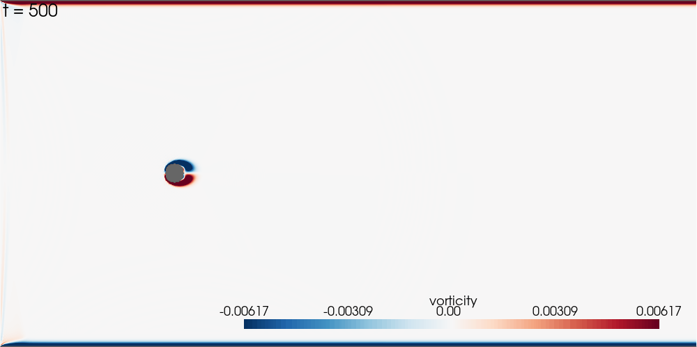

# Paralllel Implementation of the Lattice Boltzmann Method: 2D flow past a cylinder
### Ghassan Abboud



This project sought to implement parallel versions of a 2D lattice Boltzmann solver both on CPU clusters using MPI and on NVIDIA GPUs using CUDA. Different implementations are developed to explore the effect of data layout (AoS vs SoA) and domain decomposition on performance. The main implementations provided in this codebase are:
- `serial/`: The baseline serial implementation provided as a starting point for profiling and parallelization.
- `serial_fused_SoA/`: A serial implementation with fused collision and streaming steps in one loop, using a structure of arrays (SoA) data layout.
- `serial_fused_AoS/`: A serial implementation with fused collision and streaming steps in one loop, using an array of structures (AoS) data layout.
- `mpi_row/`: An MPI-based parallel implementation decomposing the simulation domain along rows only.
- `mpi_cart/`: An MPI-based parallel implementation using a 2D Cartesian grid decomposition of the simulation domain.
- `cuda_SoA/`: A CUDA-based parallel implementation using a structure of arrays (SoA) data layout.
- `cuda_AoS/`: A CUDA-based parallel implementation using an array of structures (AoS) data layout.

For more details on specific implementations and results of performance comparisons, kindly refer to the associated report. The best implementations in performance are `mpi_cart/` for CPU clusters and `cuda_SoA/` for GPU, while the others are included for reproducibility of comparison results. All programs print the wall time and achieved million lattice updates per second (MLUPS) at the end, which is the main performance metric.

## Build

All implementations can be built using one unified makefile in the root directory. Building requires the gcc compiler, HDF5 library, openmpi for MPI implementations, and CUDA toolkit for GPU implementations:

```bash
module load gcc hdf5 openmpi cuda
make
```

Select implementations can also be built individually by running `make` in their respective directories, e.g.:

```bash
cd mpi_row
make
```

The Makefile uses `$HDF5_ROOT` for include and library paths. If you build
locally, point it at your HDF5 installation, e.g. on macOS with Homebrew:

```bash
HDF5_ROOT=$(brew --prefix hdf5) make
```


## Run

All programs take `key=value` arguments. All defaults are set for a verification test which should yield a Strouhal number of 0.16. 

```bash
mkdir -p out
./lbm                                  # uses defaults (see table below)
./lbm nx=400 ny=100 re=100 steps=20000 # explicit overrides
```

Useful keys:

| key       | meaning                                                 | default      |
|-----------|---------------------------------------------------------|--------------|
| `nx`      | cells along x                                           | 800          |
| `ny`      | cells along y                                           | 400          |
| `re`      | Reynolds number based on cylinder diameter              | 100          |
| `u_in`    | inlet velocity (lattice units; keep `u_in` ≪ 1/√3)      | 0.05         |
| `steps`   | number of time steps                                    | 60000        |
| `every`   | write a snapshot every `every` steps; 0 disables output | 500          |
| `out`     | output prefix; produces `out/lbm.xdmf` + `out/lbm_*.h5` | `out/lbm`    |
| `cyl_x`   | first cylinder center, x                                | `nx/4`       |
| `cyl_y`   | first cylinder center, y                                | `ny/2`       |
| `cyl_r`   | first cylinder radius                                   | `ny/40`      |
| `cyl2_*`  | second cylinder; set `cyl2_r > 0` to enable             | disabled     |
| `probe_x` | velocity probe, x                                       | `cyl_x + 8r` |
| `probe_y` | velocity probe, y                                       | `cyl_y`      |
| `probe`   | probe CSV path                                          | `probe.csv`  |

Additional keys are available for GPU implementations to control grid and block dimensions.

| key       | meaning                                                 | default      |
|-----------|---------------------------------------------------------|--------------|
| `block_x` | number of threads in block along x                      | 256          |
| `block_y` | number of threads in block along y                      |   1          |
| `grid_x`  | number of blocks in grid along x                        | `ceil(nx,block_x)` |
| `grid_y`  | number of blocks in grid along y                        | `ceil(ny,block_y)`  |

### Serial example

```bash
mkdir -p out
./serial_fused_SoA/lbm_fused_SoA nx=800 ny=400 u_in=0.05 re=100 steps=60000 every=500 out=out/lbm
python3 viz/strouhal.py probe.csv --u-in 0.05 --diameter 20   # expect St ≈ 0.16
```

### MPI examples

Run with `srun` on SCITAS EPFL clusters. The number of MPI ranks must evenly
divide `ny` for `mpi/` (row decomposition). For `mpi_cart/` (2D decomposition), `nx` and `ny` must evenly divide the rank grid dimensions chosen by `MPI_Dims_create`.

```bash
mkdir -p out

# 2D Cartesian decomposition with 16 ranks (4×4 grid)
srun --nodes=1 --ntasks=16  ./mpi_cart/lbm_mpi_cart nx=3200 ny=3200 u_in=0.05 re=100 steps=60000 every=500 out=out/lbm_mpi_cart

# Row decomposition with 16 ranks
srun --nodes=1 --ntasks=16  ./mpi_row/lbm_mpi_row nx=800 ny=400 u_in=0.05 re=100 steps=60000 every=500 out=out/lbm_mpi_row
```

### GPU examples
Run with `srun` on SCITAS EPFL clusters. 

```bash
# 1D thread blocks of 256 threads along x (default, recommended)
srun --gres=gpu:1 --nodes=1 --partition=gpu \
  ./cuda_SoA/lbm_cuda_SoA nx=4096 ny=2048 u_in=0.05 re=100 steps=60000 every=500

# Override block dimensions for a 2D configuration
srun --gres=gpu:1 --nodes=1 --partition=gpu \
  ./cuda_SoA/lbm_cuda_SoA nx=4096 ny=2048 u_in=0.05 re=100 steps=60000 every=500 block_x=64 block_y=4

# AoS layout version
srun --gres=gpu:1 --nodes=1 --partition=gpu \
  ./cuda_AoS/lbm_cuda_AoS nx=4096 ny=2048 u_in=0.05 re=100 steps=60000 every=500
```

### Performance sweep configurations

To conduct performance analyses, a bash routine was developed to automate the execution of multiple runs with varying parameters. Diameter was added to the run's output to automate estimation of the Strouhal number from the probe signal. Here is an example of such a sweep for the CUDA SoA problem size analysis. 


```bash
#!/bin/bash
#SBATCH --nodes=1 --time=02:00:00 --partition=gpu --gres=gpu:1
#SBATCH --account=FILL --job-name=cuda_size_sweep
#SBATCH --output=./out/cuda_sweep_problem_size_SoA/log_%j.out

module load gcc hdf5 cuda

NX_VALUES=(128 256 512 1024 2048 4096 8192)
NY_VALUES=(64  128 256 512  1024 2048 4096)
STEPS=60000; BLOCK_X=256; BLOCK_Y=1
OUTPUT_DIR=./out/cuda_sweep_problem_size_SoA
mkdir -p "${OUTPUT_DIR}"
RESULTS_CSV=${OUTPUT_DIR}/results.csv
if [ ! -f "${RESULTS_CSV}" ]; then
    echo "nx,ny,total_cells,block_x,block_y,u_in,reynolds,replicate,wall_time_s,mlups,strouhal" > ${RESULTS_CSV}
fi

U_IN=0.05
REYNOLDS=100
N_REPLICATES=3
EVERY=0

for i in "${!NX_VALUES[@]}"; do
    NX=${NX_VALUES[$i]}
    NY=${NY_VALUES[$i]}

    for REP in $(seq 1 ${N_REPLICATES}); do
        # Skip this (nx, ny, block_x, block_y, replicate) combination if it already has a row in the CSV.
        if awk -F',' -v nx="${NX}" -v ny="${NY}" -v bx="${BLOCK_X}" -v by="${BLOCK_Y}" -v rep="${REP}" \
            'NR>1 && $1==nx && $2==ny && $4==bx && $5==by && $8==rep {found=1} END {exit !found}' "${RESULTS_CSV}"; then
            echo "Skipping NX=${NX} NY=${NY} BLOCK_X=${BLOCK_X} BLOCK_Y=${BLOCK_Y} REP=${REP} — already in ${RESULTS_CSV}"
            continue
        fi

        SPECIFIC_OUTPUT_DIR=${OUTPUT_DIR}/nx_${NX}_ny_${NY}_rep_${REP}_block_x_${BLOCK_X}_block_y_${BLOCK_Y}
        RUN_LOG=${SPECIFIC_OUTPUT_DIR}/run.log
        PROBE_PATH=${SPECIFIC_OUTPUT_DIR}/probe.csv
        mkdir -p ${SPECIFIC_OUTPUT_DIR}
        srun ./cuda_SoA/lbm_cuda_SoA nx=${NX} ny=${NY} every=${EVERY} out=${SPECIFIC_OUTPUT_DIR}/lbm probe=${PROBE_PATH} re=${REYNOLDS} u_in=${U_IN} steps=${STEPS} block_x=${BLOCK_X} block_y=${BLOCK_Y} \
            | tee ${RUN_LOG}
        WALL=$(awk '/Wall time/{print $4}' ${RUN_LOG})
        MLUPS=$(awk '/MLUPS/{print $3}'    ${RUN_LOG})

        DIAMETER=$(awk '/diameter/{print $3}' ${RUN_LOG})
        echo "Diameter: ${DIAMETER}"
        ST_LOG=${OUTPUT_DIR}/strouhal_nx_${NX}_ny_${NY}_rep_${REP}.log
        python3 viz/strouhal.py ${PROBE_PATH} --u-in ${U_IN} --diameter ${DIAMETER} \
            | tee ${ST_LOG}
        ST=$(awk '/^St/{print $3}' ${ST_LOG})

        echo "${NX},${NY},$((NX*NY)),${BLOCK_X},${BLOCK_Y},${U_IN},${REYNOLDS},${REP},${WALL},${MLUPS},${ST}" >> ${RESULTS_CSV}
    done
done
```


## What the program does and writes

Each step performs collision (BGK), bounce-back at solid cells, streaming,
and inlet/outlet boundary conditions. The solver records:

- `out/lbm.xdmf` together with `out/lbm_*.h5` — open `out/lbm.xdmf` directly
  in ParaView, or feed it to the Python script in `viz/`. Each snapshot
  contains density, velocity components, and vorticity.
- `probe.csv` — `(step, ux, uy)` at a probe point a few cylinder diameters
  downstream. Used by `viz/strouhal.py` to estimate the shedding frequency.


## Visualization

The two scripts in `viz/` consume the solver output. They depend on a
small set of Python packages — install them with `pip` or `conda`:

```bash
pip install pyvista numpy h5py imageio matplotlib
# or, if you created the conda env above, these are already installed.
```

Then:

```bash
python3 viz/viz.py out/lbm.xdmf            # produces vorticity.gif
python3 viz/strouhal.py probe.csv \
        --u-in 0.05 --diameter 20          # prints Strouhal number
```

For Karman shedding to develop fully and the FFT to find a clean peak, run
at least 50 000–60 000 steps with the default geometry, and higher resolutions may require more steps. 
